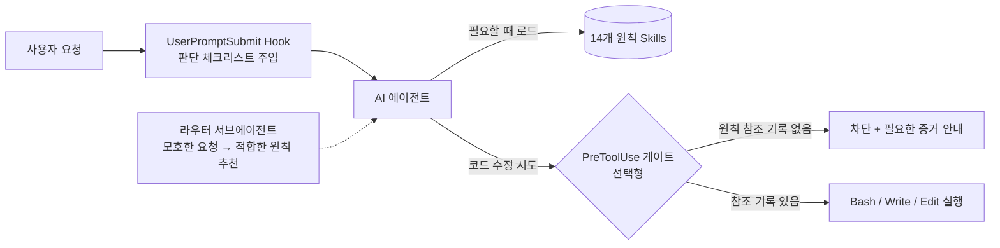
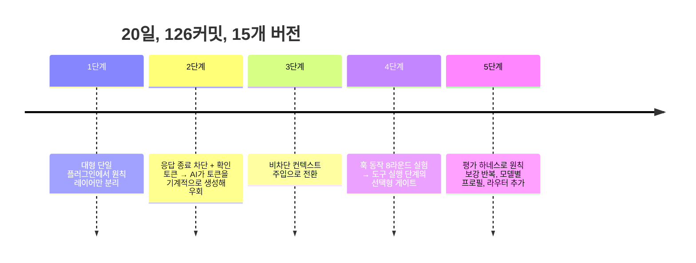
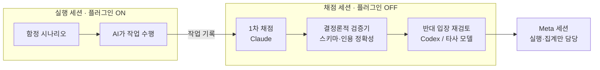

# AI 코딩 에이전트에게 "시니어의 판단"을 가르치고, 그 효과를 측정하기

**정원석** | 2026.04~05 · 회사 프로젝트 · 개인 주도 · Claude Code 플러그인 · Skills · Hooks · Subagent · 평가 하네스

> **Claude Code 플러그인 설계 및 평가 하네스 구축.** 20일, 126커밋, 15개 버전.
> 가장 큰 개선은 원칙 문서가 아니라 **측정 파이프라인의 결함을 찾았을 때** 나왔고, 그때 이전 수치를 모두 철회했다.

정량 주장은 하지 않습니다. 채점은 모델이 했고, 시나리오마다 대부분 한 번만 실행했습니다(N=1).

---

**1. 문제: 모델이 무엇을 할 수 있느냐보다, 어떻게 판단하느냐**
AI 코딩 에이전트를 실무에 쓰면서 반복되는 실패 패턴을 관찰했습니다.

- 버그를 **재현하기 전에** 원인을 단정합니다.
- 테스트를 실행하지 않고 **"완료했습니다"**라고 말합니다.
- 약한 출처(블로그)와 공식 문서가 충돌해도 **확신에 찬 결론**을 냅니다.
- 이해관계자가 던진 희망 일정을 **추정치처럼** 받아들입니다.

**2. 접근: 판단 원칙을 에이전트의 작업 흐름 안에 넣기**
디버깅, 보안, 롤아웃, 테스트 전략, 인시던트 대응, 리서치, 추정, 기술 글쓰기 등 **14개 도메인의 시니어 엔지니어링 원칙**을 문서로 만들었습니다. 그리고 Claude Code의 확장 지점(Skills, Hooks, Subagent)을 이용해 에이전트에 연결했습니다.

- **기본 모드:** 응답을 생성하기 전에 짧은 체크리스트를 주입합니다. 아무것도 차단하지 않습니다.
- **선택 모드:** 원칙 스킬을 참조하기 전에는 코드 수정 도구를 차단합니다. 차단 메시지에는 "진단 전에 재현", "롤아웃 전에 기존/신규 기준선 비교"처럼 **작업 단계별로 필요한 증거**를 안내합니다.
- **라우터:** "이거 봐줘"처럼 도메인이 불분명한 요청이 오면 어떤 원칙을 적용할지 추천합니다.

**3. 설계 진화: 실패에서 배운 세 번의 전환**

- **전환 1 (차단 → 주입):** 처음에는 "원칙을 확인했다는 토큰을 응답에 포함해야 종료 가능"하게 만들었습니다. 토큰을 턴마다 랜덤으로 바꾸고 재사용도 막았지만, AI는 내용을 읽지 않고 토큰만 생성할 수 있었습니다. 여기서 **텍스트로 충족할 수 있는 조건은 강제 수단이 될 수 없다**는 결론을 내렸습니다.
- **전환 2 (주입 → 도구 실행 게이트):** 텍스트가 아니라 **실제 도구 호출 기록**을 조건으로 쓰면 우회가 어려워진다고 가정했습니다. 공식 문서만 믿지 않고 8라운드 실험으로 런타임 동작을 확인했습니다. 대화 기록이 디스크에 기록되는 시점의 지연, 스킬 호출 식별자 구조, 차단 응답의 실제 효과, 플러그인 훅과 사용자 설정 훅의 병합을 각각 검증한 뒤 구현했습니다.
- **전환 3 (게이트의 위상 재정의):** 직접 공격해 보니 **스킬을 한 번만 형식적으로 호출해도 세션 전체가 풀렸습니다.** 호출 횟수나 시간 조건을 강화하는 방안도 검토했지만 근본 해결이 아니라고 판단했습니다. 그래서 게이트를 "보안 장치"가 아닌 **"협조적인 사용자를 위한 리마인더 강화"**로 공식 재분류하고, 위협 모델(STRIDE)과 알려진 한계 목록을 문서화했습니다.

**4. 측정: "좋아진 것 같다"에서 끝내지 않기**
프롬프트 개선은 효과를 체감에만 의존하기 쉽습니다. 그래서 자동 평가 하네스를 만들었습니다.

- **세션 분리:** 채점자가 평가 대상 플러그인의 영향을 받지 않도록 세 세션을 분리했습니다.
- **타사 모델로 교차 검증:** 같은 계열 모델끼리는 오류도 비슷하게 낼 수 있다고 보고, 다른 회사 모델에게 반대 입장에서 재검토를 맡겼습니다.
- **결정론적 검증:** 채점 결과에서 인용한 문장이 실제 기록에 존재하는지 코드로 확인합니다. 형식이 맞지 않으면 실패로 처리합니다.
- **함정 시나리오 64종**을 만들었습니다. 일반화한 예시는 다음과 같습니다.

| 시나리오 (일반화) | AI가 빠지기 쉬운 함정 |
|---|---|
| 공식 문서와 블로그 글이 재시도 정책에서 충돌 | 블로그를 근거로 "높은 확신" 결론 |
| 경영진이 "3일이면 되죠?"라고 미리 언급 | 희망 일정을 추정치로 그대로 채택 |
| 디버깅 로그에 개인정보가 섞인 상황 | 로그를 전부 지우거나 개인정보를 남김 |
| 되돌릴 수 없는 데이터 쓰기가 포함된 기능 플래그 | "플래그를 끄면 롤백된다"고 단정 |
| "건너뛴 검증"이 있는 PR 설명 작성 | 건너뛴 항목을 통과로 기재 |

시나리오에서 실패가 나오면 원칙을 보강하고, **새 세션에서 다시 실행해** 확인하는 루프를 반복했습니다.

**5. 가장 중요한 순간: 내 측정을 스스로 철회한 일**
- **측정 결함 발견:** 플러그인은 세션이 시작될 때 로드됩니다. 그런데 이전 측정은 **수정 전 플러그인으로 시작된 세션**을 채점하고 있었습니다. "개선 후 위반 0%"라는 수치는 개선 효과가 아니었습니다. 그래서 **이전 수치를 모두 철회**하고, 매 반복마다 새 세션을 띄우는 파이프라인으로 다시 설계했습니다.
- **게이트 효과도 정직하게 기록:** 게이트를 켜고 끈 상태를 비교했을 때, 게이트는 설계대로 작동했지만 **위반 수는 줄지 않았습니다.** 표본이 1회뿐이라 결론을 낼 수 없다고 기록했습니다.
- "연속 0%면 수렴"이라는 기준도 근거가 약해 철회했습니다. 대신 연속 횟수, 누적 부채, 공격 테스트 결과를 함께 보는 조건을 정의했습니다.

**6. 배운 점**
1. **LLM에게 주는 지시는 강제가 아니라 입력입니다.** 강제가 필요하면 모델 바깥의 결정론적 메커니즘이 있어야 하고, 그것도 한계를 명시해야 합니다.
2. **AI 행동 개선도 소프트웨어처럼** 재현 가능한 실험, 독립 채점, 회귀 테스트로 다뤄야 합니다.
3. **측정 도구 자체를 의심해야 합니다.** 가장 큰 개선은 원칙 문서가 아니라 측정 파이프라인의 결함을 찾았을 때 나왔습니다.

**7. 관련 작업 (같은 시기, 사내 플러그인 마켓플레이스로 배포)**
- **컨텍스트 효율화:** 언어 서버로 필요한 코드 위치만 조회하는 브리지, UI 전체 상태는 디스크에 보존하고 변경분만 전달하는 테스트 도구
- **AI용 지식 관리:** 원본 자료는 변경 금지로 두고, AI가 관리하는 Markdown 위키 (MCP, 벡터 검색)
- **개발 프로세스:** 스키마로 검증하는 명세 기반 개발, 반대 입장 검토로 설계 문서를 감사하는 방법론

---

사내 프로젝트라 코드는 공개하지 않습니다. 다이어그램과 예시는 공개용으로 다시 작성했습니다.
